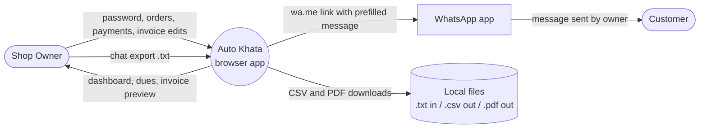
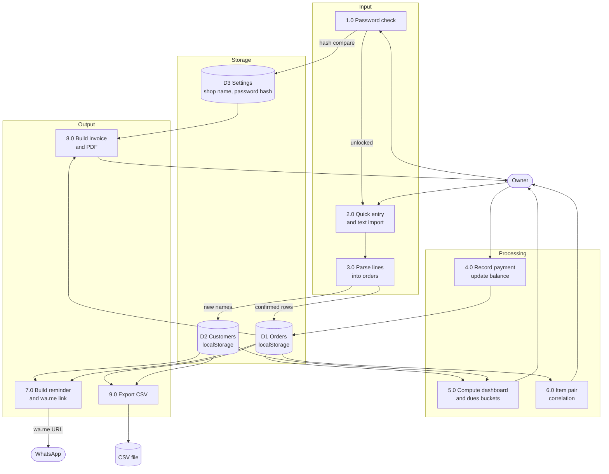

# Auto Khata: Data Flow Diagram

All processing happens in the browser. There is no server and no database. The only external hand-off is the WhatsApp link, which the owner taps.

## Level 0: Context Diagram

## Level 1: Main Processes

## Process Descriptions

| ID | Process | Input | Output | Notes |
|----|---------|-------|--------|-------|
| 1.0 | Password check | Typed password | Unlock or deny | Compare SHA-256 with salt. Set on first run. |
| 2.0 | Quick entry and import | Text box line or `.txt` file | Raw lines | Import shows unparsed lines separately. |
| 3.0 | Parse lines | Raw line | Order row or error | Regex: customer, qty, unit, item, amount, status. Owner confirms before save. |
| 4.0 | Record payment | Customer, amount | Updated paid and balance | Supports partial payments. |
| 5.0 | Dashboard and dues | Orders, customers | Totals, dues buckets | Buckets: 0-7, 8-30, 30+ days. |
| 6.0 | Item correlation | Orders grouped by bill or day | Item pair counts | Simple pair count, top 10. |
| 7.0 | Reminder | Customer, balance, shop name | Prefilled wa.me URL | Message editable. Owner taps Send. |
| 8.0 | Invoice | Customer orders, shop settings | Editable invoice, PDF | Print-to-PDF or client-side library. |
| 9.0 | CSV export | All orders and customers | CSV file | UTF-8 with header row. |

## Data Stores

| Store | Fields | Persistence |
|-------|--------|-------------|
| D1 Orders | id, date, customer, item, quantity, unit, amount, paid, due_date, status | localStorage (key: `autokhata.orders`) |
| D2 Customers | name, phone | localStorage (key: `autokhata.customers`) |
| D3 Settings | shop_name, password_salt, password_hash, default_language | localStorage (key: `autokhata.settings`) |

## Trust Boundaries

- Browser to local storage: data stays on the device.
- Browser to WhatsApp: only a URL is opened. No data is sent by the app.
- Browser to file system: owner-initiated downloads only.
