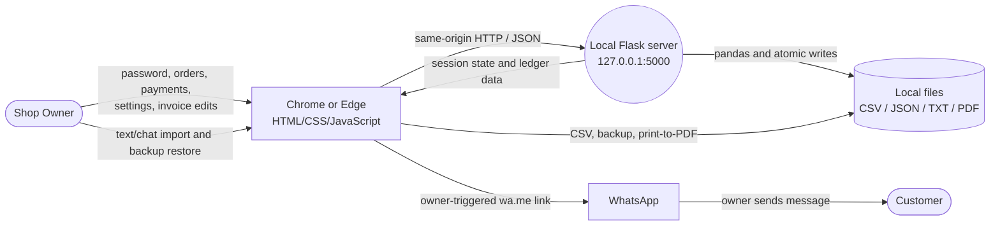
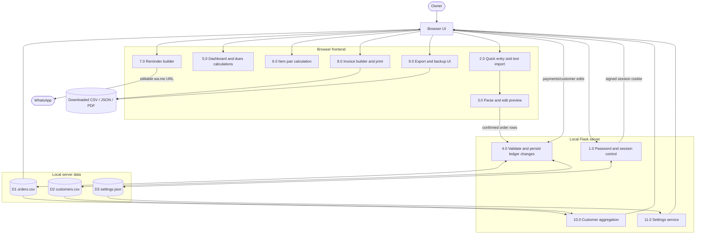

# Auto Khata: Data Flow Diagram

**Version:** 0.2  
**Current architecture:** Browser frontend → local Flask API → pandas-managed CSV/JSON files

Auto Khata runs on the owner's PC. Flask listens only on `127.0.0.1:5000`; it is not exposed to the LAN or internet. Ledger data remains on the PC. The only intentional external hand-off is a WhatsApp `wa.me` link opened by the owner.

## Level 0: Context Diagram

## Level 1: Application Processes

## Process Descriptions

| ID | Process | Input | Output | Implementation notes |
|---|---|---|---|---|
| 1.0 | Password and session control | Set-password, login, lock requests | Unlock/deny state and signed session cookie | Password hash uses `hashlib.scrypt`; plain password is never persisted. |
| 2.0 | Quick entry and import | Typed lines or `.txt` file | Clean raw order lines | Import supports plain lines and recognized WhatsApp headers. |
| 3.0 | Parse and edit preview | Raw lines | Editable order rows and unparsed lines | Nothing is persisted until Confirm and save. |
| 4.0 | Validate and persist | Confirmed rows, customers, payments | Updated CSV records or API error | Flask validates shapes; pandas writes temporary files and `os.replace()` commits them. |
| 5.0 | Dashboard and dues | Cached orders/customers | Totals, rankings, debt buckets | Performed in the browser after authenticated API reads. |
| 6.0 | Item pair calculation | Orders grouped by customer/date | Ranked item pairs | Counts co-occurring distinct items. |
| 7.0 | Reminder builder | Customer, phone, balance, shop name | Editable message and `wa.me` URL | Owner must press Send in WhatsApp. |
| 8.0 | Invoice and print | Selected orders and settings | Editable invoice and print view | Browser print dialog provides Save as PDF. |
| 9.0 | Export and backup UI | Cached orders, customers, safe settings | Downloaded CSV or JSON | Downloads are initiated by the owner. |
| 10.0 | Customer aggregation | D1 and D2 records | Sales, paid, balance, oldest unpaid date | Returned by `GET /api/customers`. |
| 11.0 | Settings service | Shop name read/write | Safe frontend settings | Password hash and session secret are never returned by this endpoint. |

## Data Stores

| Store | Location | Fields | Writer |
|---|---|---|---|
| D1 Orders | `data/orders.csv` | `id`, `date`, `customer`, `item`, `quantity`, `unit`, `amount`, `paid`, `due_date`, `status` | pandas through `data.py` |
| D2 Customers | `data/customers.csv` | `name`, `phone` | pandas through `data.py` |
| D3 Settings | `data/settings.json` | `shop_name`, `password_salt`, `password_hash`, `default_language`, `session_secret` | JSON atomic-write helper in `data.py` |

The application creates D1 and D2 with header rows on first run. All three stores are written through a temporary file in the same directory, followed by `os.replace()`.

## API Data Flows

| Method and path | Request flow | Response flow |
|---|---|---|
| `GET /api/status` | Browser → Flask | `password_set`, `unlocked` |
| `POST /api/password/set` | New password → Flask | First password created and session unlocked |
| `POST /api/login` | Password → Flask | Session unlocked or generic wrong-password error |
| `POST /api/lock` | Browser → Flask | Session cleared |
| `GET /api/orders` | Browser session → Flask → D1 | Array of order records |
| `POST /api/orders` | Validated order array → Flask → D1/D2 | Saved records/count or validation error |
| `POST /api/payments` | Order ID and amount → Flask → D1 | Updated paid amount and status |
| `GET /api/customers` | Browser session → Flask → D1/D2 | Customer aggregates |
| `POST /api/customers` | Customer array → Flask → D2 | Saved customer records |
| `GET /api/settings` | Browser session → Flask → D3 | Shop name and default language only |
| `POST /api/settings` | Shop name → Flask → D3 | Updated safe settings |

## Trust Boundaries

1. **Browser ↔ Flask:** Same-origin HTTP on loopback. Protected ledger routes require the signed Flask session.
2. **Flask ↔ filesystem:** The server process can read and replace files in `data/`. CSV contents are plaintext.
3. **Browser ↔ imported/downloaded files:** File selection and downloads require owner action.
4. **Browser ↔ WhatsApp:** Auto Khata opens a prepared URL only. WhatsApp receives the data in that URL after owner action.
5. **PC ↔ network:** Core ledger operations remain local. The server must not bind to `0.0.0.0` in the current security model.

## Security and Data Notes

- The password is a casual access lock, not ledger encryption.
- Filesystem access bypasses the UI lock because CSV/JSON data is not encrypted.
- The session secret is generated on first run and persisted in D3; it is not hard-coded.
- A page refresh may remain unlocked while the browser session cookie is valid. Clicking Lock explicitly clears it.
- Old browser `localStorage` is outside these server stores and is not migrated automatically.
